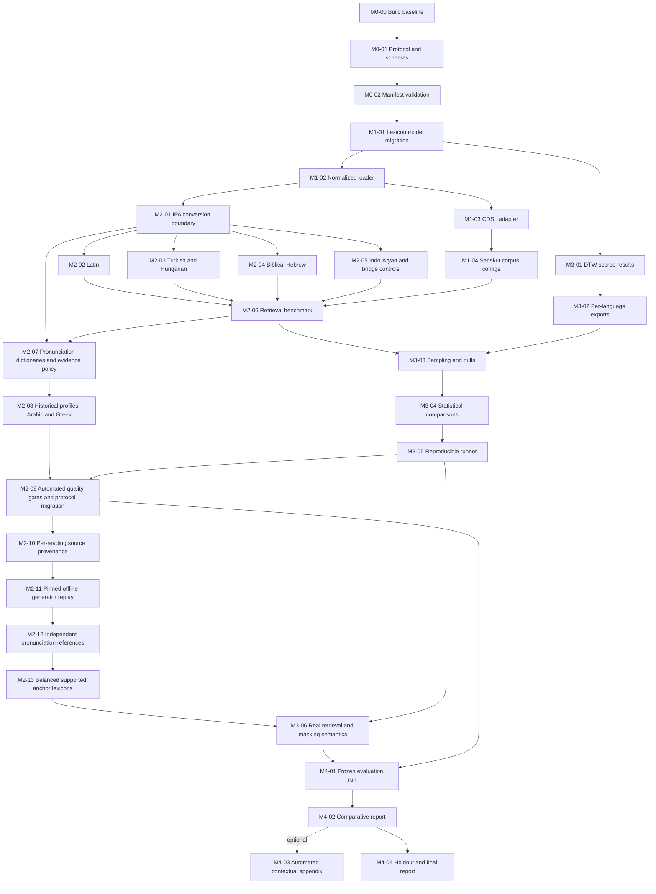

# Milestone Pull Request Specifications

<!-- markdownlint-disable MD036 -->

This document turns the milestones in the
[improvement plan](improvement-plan.md) into reviewable pull requests. The PRs
are ordered by dependency, but PRs that share only a completed prerequisite may
be developed in parallel. A PR must not include the work assigned to a later PR
merely because the adjacent code is convenient to change.

## Automation-first revision (2026-11-05)

The current roadmap requires no human pronunciation labeling or semantic
annotation. Prefer online pronunciation dictionaries and use automated,
provenance-aware evidence and retrieval gates. The language assumptions are
ecclesiastical Latin, Tiberian Biblical Hebrew, Classical Arabic, and an
Ancient/Classical Greek lexicon with Koine pronunciation only, alongside the
existing comparison languages.

M0 through M3 have merged implementations. M2-01 through M2-06 below retain their
original scopes as implementation history, not current requirements to recruit
reviewers or use Classical Latin pronunciation. M2-07 through M2-09 supersede
their pronunciation sourcing, profile selection, and human-review acceptance
criteria. The original source-availability decisions in the modern Indo-Iranian
panel must also be re-evaluated against dictionary pronunciation coverage.
These new implementation PRs are prerequisites to M4-01, not algorithmic changes
to slip into a data release.

Preserve old frozen configurations, schemas, and results. Add a versioned
replacement protocol and explicit runner support; documentation changes do not
make current human-review validators pass. Do not populate human decisions with
automated labels. M4-03 is now an optional automated appendix and does not block
the holdout or final report.

## Conventions for every PR

Every PR description must contain:

- the milestone and PR identifier from this document;
- a one-paragraph statement of the behavior or research capability added;
- links to its prerequisite PRs and upstream data/tool versions;
- a list of generated or changed artifacts;
- commands used to build, test, validate data, and regenerate outputs;
- test results and data-quality counts before and after the change;
- licensing/provenance effects, including a statement when there are none;
- known limitations and explicitly deferred work;
- a checklist mapping the implementation to every acceptance criterion below.

All generated files must be deterministic for fixed inputs, configuration, and
seed. Sort records before serialization, write invariant-culture numbers, use
UTC ISO 8601 timestamps only in metadata that is excluded from content hashes,
normalize line endings, and never depend on filesystem enumeration order.

Third-party data must not be committed unless its redistribution terms have
been reviewed. Tests use small, attributed fixtures that are either synthetic,
public domain, or permitted by the source license. Full acquisition is an
explicit command and writes under a gitignored raw-data directory.

The core library remains compatible with `netstandard2.0` until a dedicated
compatibility decision changes it. Tests must run on a supported .NET SDK; no PR
may require the unsupported `netcoreapp2.0` runtime without documenting and
automating that requirement.

## Dependency map

## Milestone 0: Protocol and manifests

### M0-00: Establish a supported build and test baseline

**Purpose:** make a fresh checkout buildable and testable on .NET 10 before
research behavior changes.

**Scope**

- Pin the .NET 10 SDK and its roll-forward policy in `source/global.json`.
- Set `net10.0` and shared compiler/analyzer behavior in
  `source/Directory.Build.props`; remove per-project target framework values.
- Enable NuGet central package management in
  `source/Directory.Packages.props`, move every package version there, and
  remove package versions from individual projects.
- Convert both test projects to `MSTest.Sdk`, pin its SDK version in
  `global.json`, and use Microsoft Testing Platform as the test runner. Remove
  the legacy test SDK, adapter, framework, and Visual Studio service entries
  that `MSTest.Sdk` replaces.
- Remove compatibility package references supplied by .NET 10, including
  `System.Dynamic.Runtime` and `System.ValueTuple`.
- Keep analyzers and nullable flow analysis enabled. Record pre-existing
  diagnostic codes in a temporary `WarningsNotAsErrors` migration baseline so
  unrelated warning categories remain build-breaking; do not disable analyzers
  or warnings-as-errors globally.
- Convert `source/Enochian.sln` to `source/Enochian.slnx`, preserve all project
  and solution-item membership, and remove the old solution file.
- Add one repository-level build/test command to the README or a script/task.
- Add CI for restore, build, and both test projects on Windows. A second Linux
  job is desirable because acquisition and deterministic serialization must be
  cross-platform, but it may be deferred if current path handling prevents it.
- Capture the pre-existing test count and identify any skipped or
  environment-dependent integration test.

**Tests**

- `dotnet build source/Enochian.slnx` succeeds from a clean restore.
- All existing unit and integration tests are discovered and run.
- A clean checkout CI job exercises the same commands documented for local use.

**Acceptance criteria**

- All six projects target `net10.0` through shared build properties.
- The .NET and MSTest SDK versions are pinned and governed by an explicit
  roll-forward rule.
- Individual project files contain no package version numbers.
- The SLNX solution contains the same projects and solution items as the former
  SLN solution.
- The build reports legacy baseline warnings but fails for warning codes outside
  the documented baseline.
- CI and local commands agree on test discovery and pass/fail status.
- Any pre-existing failure is documented and separately tracked, not silently
  ignored or converted to a passing assertion.

**Out of scope:** broad dependency upgrades unrelated to .NET 10 compatibility,
code formatting, feature changes, and data acquisition.

### M0-01: Freeze the research protocol and define schemas

**Purpose:** create machine-readable contracts for the experiment before
comparative results can influence analysis choices.

**Scope**

- Add a versioned experiment configuration schema covering corpus split,
  transcription and mapping versions, tokenization, feature set, DTW settings,
  length filters, lexicon filters, seeds, sample counts, planned contrasts,
  correction method, and output locations.
- Add a versioned source-manifest schema covering source ID, language/family,
  URL, commit/tag/release, retrieval date, checksum, license/SPDX expression,
  citation, parser version, raw path, and generated artifact path.
- Add a versioned normalized-entry schema with the fields specified in the
  improvement plan. Define required fields, enums, nullability, Unicode form,
  and ID construction.
- Check in an exploratory config and a confirmatory protocol template. The
  confirmatory template must name an evaluation partition and a holdout
  partition without including results.
- Write inclusion/exclusion rules for uncertain Voynich tokens, minimum and
  maximum phoneme lengths, proper names, abbreviations, duplicate forms, parts
  of speech, and inflected forms.
- State the primary statistic and contrasts in machine-readable fields and prose.

**Interfaces and artifacts**

- `experiments/schemas/experiment.schema.json`
- `resources/lexicons/schemas/source-manifest.schema.json`
- `resources/lexicons/schemas/normalized-entry.schema.json`
- `experiments/exploratory.example.json`
- `experiments/confirmatory.protocol.json`
- protocol documentation explaining every non-obvious field

Names may be adjusted to existing conventions, but schema IDs and versions must
be stable once released.

**Tests**

- Valid example documents pass schema validation.
- Fixtures fail for missing version, missing checksum, unknown entry kind,
  invalid language code, unspecified random seed, and overlapping evaluation
  and holdout partitions.
- JSON serialization round-trips without losing fields.

**Acceptance criteria**

- A reviewer can determine exactly which data and analysis choices are frozen.
- Evaluation and holdout loci are disjoint and selected without comparative
  language scores.
- Schema versions are present in every instance and unknown major versions fail
  with a useful error.
- No actual language-comparison output is added.

**Out of scope:** downloading sources, parsing dictionaries, matching, and
statistical implementation.

### M0-02: Validate manifests, checksums, and licenses

**Purpose:** make source provenance and redistribution constraints executable
rather than informal notes.

**Scope**

- Add a manifest validator available from the console application or a small
  repository tool.
- Validate schema, URL, pinned revision, SHA-256 format, local checksum when a
  file exists, unique source IDs, and allowed license expressions.
- Add initial manifests for CDSL MW/AP/PWG/PW/SHS, RomLex, UniMorph candidates,
  Perseus, Zemberek, Magyar Ispell, BHSA, and Open Scriptures. A manifest may be
  marked `planned` until an exact artifact and checksum are acquired.
- Add explicit distribution policy values such as `vendored`,
  `download-on-demand`, and `metadata-only`.
- Mark BHSA as optional/non-commercial and prevent it from being bundled by the
  default acquisition/package path.
- Add an attribution report generated solely from manifests.

**Tests**

- Reject checksum mismatch, duplicate source ID, floating `main`/`master`
  revision, absent license, and a non-commercial source marked for default
  bundling.
- Generate a stable attribution report from fixture manifests.
- Validate all checked-in manifests without network access.

**Acceptance criteria**

- A fresh checkout validates all metadata-only and fixture manifests offline.
- Every planned source has an owner, upstream location, license status, and
  distribution policy; unresolved terms are visibly `unverified` and block
  bundling.
- Validation failures identify the manifest and field.
- The PR contains no unreviewed full dictionary data.

**Milestone 0 exit:** the build is reproducible, schemas are validated, the
protocol records the primary analysis before results exist, and every source has
an auditable distribution decision.

## Milestone 1: Sanskrit expansion

### M1-01: Migrate the lexicon model and cache safely

**Depends on:** M0-02.

**Purpose:** represent provenance and duplicate lemmas without breaking cache
loading or existing RomLex/SHS/CMU flows.

**Scope**

- Extend `LexiconEntry` with stable entry ID, language, family, source ID,
  source record ID, form, entry kind, dialect, part of speech, frequency,
  source encoding, and IPA. Define which fields are optional.
- Replace the one-to-one `EntriesByLemma` contract with a one-to-many index.
  Preserve a compatibility helper only if existing callers require it, and
  define deterministic ordering for homographs and multiple pronunciations.
- Version the binary cache format. Old caches must be rejected and rebuilt,
  never partially read as the new shape.
- Include source/config identity in the cache key so two dictionaries with the
  same filename cannot collide.
- Open cache files with truncating semantics and write atomically through a
  temporary file to prevent stale trailing bytes or interrupted cache files.
- Update existing lexicon loaders to populate stable defaults for new fields.

**Tests**

- Round-trip every entry field through the binary cache.
- Load duplicate lemmas and retrieve all records in stable order.
- Reject the old magic/version and rebuild from source.
- Verify cache isolation for equal filenames in different paths.
- Verify interrupted/invalid caches do not replace a valid cache.
- Run existing CMU, RomLex, SHS, and flow tests.

**Acceptance criteria**

- Duplicate lemmas no longer throw during cached loading.
- Existing sample configurations continue to run without edits.
- Cache invalidation is deterministic and logged.
- Public API changes and migration instructions are documented.

**Out of scope:** generic normalized files, new dictionary parsers, score changes.

### M1-02: Add the normalized lexicon loader and quality report

**Depends on:** M1-01.

**Purpose:** make source adapters emit one format that the C# library can load
without source-specific parsing logic.

**Scope**

- Implement a streaming JSON Lines loader for the normalized-entry schema. TSV
  may be added later only if profiling demonstrates a need.
- Normalize configured textual fields to NFC while retaining source spelling.
- Convert `ipa` through the existing IPA encoding into Enochian feature vectors.
- Reject or quarantine invalid records without silently deleting unknown
  graphemes or IPA segments.
- Emit a deterministic machine-readable quality report containing total,
  accepted, rejected, unique lemma/form/phonology counts; duplicate counts;
  rejection reasons; unknown symbols; and phoneme-length histogram.
- Add configuration fields for manifest path and quality-report output.

**Tests**

- Fixtures cover NFC/NFD equivalence, duplicate IDs, duplicate lemmas, multiple
  pronunciations, unknown IPA, malformed JSON, absent required fields, and empty
  phonology.
- Quality-report counts exactly match fixture expectations.
- Loading the same fixture twice yields byte-identical reports and entry order.
- A large synthetic fixture is streamed rather than loaded as raw text at once.

**Acceptance criteria**

- Every rejected record has a source ID/line and reason.
- Unknown IPA is a counted validation failure, not a zero vector or omitted
  segment.
- Loader and report behavior are documented with a minimal flow example.
- No external acquisition tool is required to run tests.

### M1-03: Add a pinned CDSL acquisition and normalization adapter

**Depends on:** M1-02.

**Purpose:** transform the selected Cologne dictionaries into normalized,
validated artifacts through one shared adapter.

**Scope**

- Add an acquisition command that checks out or downloads the exact `csl-orig`
  commit recorded in manifests and verifies checksums.
- Parse canonical `v02/<dict>/<dict>.txt` records for MW, AP, PWG, PW, and SHS.
  Share headline/record parsing; isolate dictionary-specific markup handling.
- Extract source record ID, SLP1 headword, display form where available, and
  definition. Preserve raw headword and dictionary ID.
- Convert SLP1 with the existing encoding and also emit canonical IPA so the
  normalized loader follows the same path as other languages.
- Emit one normalized JSONL and one quality report per source.
- Record adapter version and exact transform command in generated metadata.

**Tests**

- Commit small attributed fixtures for every selected dictionary, including
  alternate headwords, homographs, markup, malformed records, and an SLP1 edge
  case.
- Snapshot expected normalized records and quality counts.
- Cross-check fixture SLP1 conversions against the existing SHS loader.
- An acquisition test using local fixture archives runs offline; network tests
  are opt-in and do not gate ordinary unit tests.

**Acceptance criteria**

- One command can acquire and normalize all five pinned sources.
- Dictionary-specific rules are documented and do not leak into the generic
  loader.
- No unknown SLP1/IPA segment remains without a reviewed allowlist entry and
  rationale.
- Full raw sources remain uncommitted unless license review explicitly approves
  vendoring.

### M1-04: Configure and verify the Sanskrit corpus panel

**Depends on:** M1-03.

**Purpose:** expose the new dictionaries to flows and construct a deduplicated
Sanskrit view without treating overlapping dictionaries as independent data.

**Scope**

- Add example lexicon configurations for MW, AP, PWG, PW, and normalized SHS.
- Add a deterministic union builder that preserves source memberships while
  deduplicating by normalized phonological form and, secondarily, lemma.
- Define primary filters for entry kind, phoneme length, and malformed markup.
- Produce an aggregate report with per-source counts, overlap matrix, union
  counts, and exclusion reasons.
- Compare legacy and normalized SHS counts and explain every discrepancy above
  a predeclared tolerance.
- Add a small Sanskrit integration flow that searches each lexicon separately.

**Tests**

- Union fixtures prove that overlapping records collapse once while retaining
  all source IDs.
- Output does not change when source input order changes.
- Integration test loads all fixture lexicons and identifies their source in
  returned entries.
- Legacy/normalized SHS comparison test uses a committed miniature fixture.

**Acceptance criteria**

- Reports distinguish per-dictionary evidence from union evidence.
- Duplicate handling is deterministic and documented.
- Full-corpus quality reports have zero unexplained unknown symbols.
- Existing `samples/voynich.json` behavior is preserved or migrated with a
  documented before/after comparison.

**Milestone 1 exit:** all selected Sanskrit dictionaries pass fixture tests and
quality checks, can be run independently, and can be combined without inflating
overlap.

## Milestone 2: Multilingual control panel

M2-01 through M2-06 describe the merged baseline. For remaining work, apply the
superseding M2-07 through M2-09 specifications below.

### M2-01: Define the IPA conversion-provider boundary

**Depends on:** M1-02.

**Purpose:** make external and custom grapheme-to-phoneme conversion
reproducible without linking Python/GPL tooling into the core library.

**Scope**

- Define a conversion artifact containing source form, normalized form, IPA,
  provider ID/version, profile ID/version, status, and diagnostics.
- Add an external preprocessing command contract: UTF-8 input, deterministic
  JSONL output, nonzero exit on incomplete batches, and a machine-readable
  summary.
- Add profile metadata for Epitran and custom converters. Pin package/tool
  versions and preserve generated IPA in normalized artifacts.
- Add an IPA audit command that reports unknown segments and samples records by
  length and unusual grapheme for human review.
- Define a blinded review-sheet format with hidden language/source columns and
  fields for expected IPA, accept/reject, error category, and notes.
- Do not call Python or a network service while loading a lexicon at runtime.

**Tests**

- Round-trip conversion and review-sheet fixtures.
- Reject missing provider versions, unconverted characters, empty IPA, and
  unknown segments.
- Verify stable blinded IDs and that hidden metadata cannot be inferred from
  row order.

**Acceptance criteria**

- Every IPA string can be traced to a versioned provider/profile and source
  form.
- Runtime matching consumes frozen artifacts only.
- GPL tools, if used, execute out of process and their outputs/provenance are
  clearly separated from library licensing.

### M2-02: Add the Latin control

**Depends on:** M2-01.

**Purpose:** add a historical Indo-European control from a non-Indo-Aryan branch.

**Scope**

- Pin the Perseus Lewis and Short TEI component and record its component-level
  license; optionally use UniMorph Latin only for the separate inflected-form
  analysis.
- Add a TEI adapter that emits unique lemma records, POS, definitions, IDs, and
  source provenance.
- Implement a versioned Classical Latin phonological profile. Document choices
  for `c/g`, `v/u`, `i/j`, `qu`, `x`, Greek loans, vowel length, and stress.
- Exclude records whose pronunciation depends on unavailable vowel length from
  the primary analysis, or define and predeclare a conservative ambiguity rule.
- Produce quality and G2P audit reports.

**Tests**

- TEI fixtures cover nested senses, homographs, orthographic variants, and Greek
  text.
- A curated pronunciation fixture covers every multi-character and contextual
  rule.
- Unknown grapheme and ambiguous-length behavior is explicit and counted.

**Acceptance criteria**

- The run uses one named pronunciation convention only.
- Definitions do not influence inclusion or phonological conversion.
- At least 100 stratified forms are prepared for blinded review before Stage A.

### M2-03: Add Turkish and Hungarian controls

**Depends on:** M2-01. Turkish and Hungarian adapters may be separate commits
inside one PR only if they share the same Epitran integration and review process;
otherwise split this into M2-03a and M2-03b.

**Purpose:** add Turkic and Uralic controls with relatively transparent
orthographies.

**Scope**

- Pin Zemberek `master-dictionary.dict` and Magyar Ispell source/release.
- Parse lexical stems and morphological metadata without expanding all
  productive inflections.
- Exclude proper names, abbreviations, obsolete items, and malformed records
  according to the frozen policy; report each category.
- Generate IPA with pinned Epitran `tur-Latn` and `hun-Latn` profiles.
- Preserve Epitran output and conversion diagnostics in normalized artifacts.
- Produce separate quality reports and 100-item stratified blinded review sets
  for each language.

**Tests**

- Turkish fixtures cover dotted/dotless `i`, circumflexes, soft `g`, apostrophe
  boundaries, and lexicon attributes.
- Hungarian fixtures cover digraphs/trigraphs, long vowels, geminates, compound
  boundaries, and affix flags.
- Exclusion fixtures prove proper names and abbreviations cannot enter primary
  lemma sets.

**Acceptance criteria**

- Lemma counts are not inflated by generated morphology.
- Unknown grapheme/IPA rates and review accuracy satisfy the protocol threshold
  or block the language from confirmatory use.
- Source licenses and selected Magyar Ispell license option are recorded.

### M2-04: Add the optional Biblical Hebrew control

**Depends on:** M2-01.

**Purpose:** add a Semitic control while preserving the non-commercial and
optional nature of BHSA.

**Scope**

- Implement BHSA/Text-Fabric export as a separate acquisition adapter that the
  default build and test path does not require.
- Export unique lexemes with vocalized form, gloss, frequency/rank, source ID,
  and phonological representation from BHSA/`phono` when available.
- Pin the data version and cite DOI `10.17026/dans-z6y-skyh` in manifests and
  generated attribution.
- Add a CC BY 4.0 Open Scriptures or vocalized UniMorph fixture path for ordinary
  tests; do not claim it is equivalent to BHSA.
- Document treatment of matres lectionis, niqqud, shewa, dagesh, begadkefat,
  gutturals, and historical pronunciation convention.
- Ensure package/publish commands cannot include BHSA data by default.

**Tests**

- License-policy test blocks BHSA from default bundling.
- Vocalized fixtures cover ambiguous and silent marks, multiple readings, and
  Aramaic records.
- Frequency aggregation from token occurrences to unique lexemes is verified.
- Missing optional BHSA data produces a clear skip/status, not a failed build.

**Acceptance criteria**

- Biblical Hebrew is labelled as such in every artifact and report.
- Every pronunciation choice is versioned and auditable.
- A fresh checkout passes without BHSA; a documented opt-in path validates an
  authorized local snapshot.
- At least 100 stratified forms are prepared for blinded review.

### M2-05: Add modern Indo-Aryan and Indo-Iranian bridge controls

**Depends on:** M2-01.

**Purpose:** test whether any effect is specifically Indo-Aryan rather than only
Sanskrit/Romani, Indo-Iranian, or a property of one script.

**Scope**

- Select a predeclared modern Indo-Aryan panel from UniMorph based on available
  unique lemmas, script/G2P support, and license. Prefer Hindi plus at least two
  of Bengali, Marathi, Punjabi, Gujarati, Assamese, or Bhojpuri.
- Select Persian or Pashto as the non-Indo-Aryan Indo-Iranian bridge control.
- Record source quality notes and use only unique lemma columns in the primary
  analysis; keep inflected forms in separately named artifacts.
- Generate IPA with pinned Epitran profiles where supported. A language without
  an adequate converter remains `exploratory` and cannot enter the frozen panel.
- Preserve script, transliteration when used, and IPA as separate fields.
- Produce per-language quality reports and blinded review samples.

**Tests**

- UniMorph fixtures validate lemma/form/feature parsing and prove forms are not
  accidentally promoted to primary lemmas.
- Indic fixtures cover combining marks, virama, inherent vowels, nukta, and
  normalization.
- Perso-Arabic fixtures cover omitted vowels and records that must be excluded
  for uncertain phonology.

**Acceptance criteria**

- Language selection follows documented thresholds rather than observed
  Voynich scores.
- Primary and inflected-form datasets cannot be confused by IDs or paths.
- Each confirmatory language passes the same unknown-symbol and blinded-review
  thresholds as unrelated controls.

### M2-06: Implement the cross-language retrieval benchmark

**Depends on:** M1-04 and M2-02 through M2-05.

**Purpose:** validate the matching and conversion machinery on known answers
before running Voynich comparisons.

**Scope**

- Add deterministic stratified sampling of held-out entries by language,
  phoneme length, and defined unusual-grapheme categories.
- Implement versioned degradation profiles for deletion, feature merger, and
  feature masking. Profiles must be language-neutral unless a separate analysis
  is explicitly labelled.
- Compute recall@1, recall@5, recall@20, mean reciprocal rank, and normalized
  distance with and without the exact source entry in the candidate set.
- Emit per-language, per-length-band, and aggregate tidy results.
- Ingest completed blinded G2P review sheets and compute accuracy plus error
  categories; freeze the pass threshold before seeing Voynich comparisons.

**Tests**

- Synthetic identity data achieve perfect retrieval before degradation.
- A planted noisy fixture has expected deterministic ranks and metrics.
- Removing the source entry actually excludes all IDs for that source record.
- Sampling is stable for a fixed seed and changes for a different seed.
- Metric tests cover ties, no candidates, and multiple pronunciations.

**Acceptance criteria**

- Every confirmatory language passes the predeclared G2P and retrieval
  thresholds in every required length band.
- Failures block progression or downgrade the language to exploratory status;
  thresholds are not relaxed after inspecting Voynich results.
- Benchmark outputs contain no definitions or language-identifying information
  in blinded review files.

**Milestone 2 exit:** at least one Latin, Turkish, Hungarian, Biblical Hebrew,
bridge, and multi-language Indo-Aryan dataset has reproducible phonology and
passes the known-language benchmark, or is explicitly excluded before the
confirmatory experiment.

### M2-07: Acquire pronunciation dictionaries and freeze automated evidence policy

**Depends on:** M2-01 and M2-06.

**Purpose:** replace the need to recruit language reviewers with reproducible
pronunciation sourcing and explicit evidence limitations.

**Scope**

- Audit Kaikki raw Wiktextract JSONL and other licensed pronunciation lexica for
  every planned language, including Sanskrit, modern Indo-Aryan languages, the
  bridge, and the new Arabic/Greek profiles. Do not infer IPA coverage from
  dictionary entry totals. Avoid deprecated postprocessed Kaikki downloads.
- Pin dump dates, extraction/module revisions where available, checksums,
  licenses, attribution, and permitted redistribution. Preserve raw bytes
  outside the repository unless distribution is explicitly permitted.
- Add a shared adapter/join path using existing normalized lexicon contracts.
  Match normalized lemma, lexical identity, and pronunciation convention;
  count ambiguous/unmatched joins and keep homographs separate. Do not use
  Voynich matches or appealing definitions to select readings.
- Prefer convention-compatible dictionary IPA, then documented source
  phonology, then deterministic conversion. Preserve original and normalized
  IPA and alternatives with stable IDs and an explicit alternative-weight policy
  so more pronunciations cannot silently inflate one language's evidence.
- Add versioned pronunciation evidence metadata, inline or in an ID-joined
  artifact: source entry, snapshot, convention, evidence origin, generating
  module/provider, reference dependencies, and normalization/join policy.
  Distinguish supplied, template-generated, converter-generated, and unknown
  evidence. Unknown independence must remain unknown.
- Report eligible lemma totals, usable IPA coverage by convention and length,
  duplicates, exclusions, joins, and source overlap. Freeze minimum eligible
  sizes, required length-band coverage, and admission rules before Voynich
  scoring; record the measured rationale without choosing cutoffs to favor
  particular language results.
- For converter-filled readings, require at least 100 held-out, stratified
  independent reference lemmas and at least 95% normalized exact agreement.
  Report phone edit distance and disagreement categories separately. Do not tune
  a converter on these reference lemmas. Shared modules and copied sources are
  not independent references. Unvalidated generated readings are exploratory.
- Direct dictionary IPA must pass provenance, convention, normalization, and
  symbol checks; dictionary origin alone does not establish historical accuracy.
  Report template-generated/unknown derivation and freeze how those evidence
  tiers affect eligibility. No tier may silently claim human validation.

**Tests and acceptance criteria**

- Fixtures cover multiple conventions, missing IPA, multiple readings,
  ambiguous joins, template-generated IPA, copied-source dependence, and
  unknown provenance.
- Input order cannot affect normalized records, joins, or coverage counts.
- Every admitted IPA segment is supported by the frozen feature encoding;
  necessary feature changes require separate versioning and regression tests.
- Acquisition is explicit; normalization and evidence checks run offline from
  pinned inputs. Failed gates exclude/downgrade data rather than request labels.
- Publish a coverage/evidence matrix before M2-08 selects final source/profile
  routes. No confirmatory Voynich run occurs in this PR.

### M2-08: Add historical pronunciation profiles, Classical Arabic, and Greek

**Depends on:** M2-07.

**Purpose:** implement the revised historical language panel using the strongest
available automated pronunciation evidence.

**Scope**

- Replace the Latin research assumption with a named ecclesiastical/Italianate
  profile. Prefer matching dictionary IPA and version converter gap-filling.
  Preserve the old Classical profile and identify it as a different convention,
  not an interchangeable cache or artifact. Do not infer medieval regional
  uniformity from the selected assumption.
- Require Tiberian pronunciation for Biblical Hebrew. Document shewa, dagesh,
  begadkefat, gutturals, vowel distinctions, and the required vocalization/context.
  Generic Hebrew IPA or BHSA phonology is not automatically Tiberian. Exclude
  readings with insufficient information; keep BHSA optional and restricted.
- Add Classical Arabic as a full lexical test language with frozen policies for
  short vowels, vowel length, emphatics, gemination, case endings, pause, and
  article assimilation. No silent substitution of Modern Standard or dialectal
  readings and no guessed vowels from unvocalized spelling.
- Add an Ancient/Classical Greek lemma lexicon with Koine pronunciation only.
  Freeze one named dated/regional Koine convention and map source pronunciation
  labels explicitly. Test vowel mergers, diphthongs, aspiration, consonant
  changes, and stress under that convention. Do not mix Attic, Byzantine,
  modern, or distinct Koine stages.
- Revisit Turkish, Hungarian, Hindi, other Indo-Aryan languages, and the bridge
  using dictionary pronunciation before converter fallback. Historical M2-05
  exclusions remain baseline observations, not proof that dictionary data fail.
- Add versioned panel configs, manifests, attribution, provenance/evidence
  reports, and per-profile deterministic normalized artifacts.
- Register a separate Arabic astronomical vocabulary/name analysis using a
  pinned licensed catalog and deterministic rules applied across comparison
  languages. Keep proper names out of the primary lemma-only experiment; do
  not assume proposed Voynich star identifications are ground truth.

**Tests and acceptance criteria**

- Fixtures reject incompatible pronunciation labels and insufficient
  vocalization, preserve homographs/alternatives, and test the profile rules.
- Latin/Hebrew convention changes cannot reuse incompatible cache identities
  or pass under old artifact hashes.
- Arabic and Greek have complete ingestion paths and documented coverage;
  missing evidence produces explicit exploratory/excluded status, not fabricated
  readings or an alternative pronunciation chosen after seeing results.
- No comparative Voynich result determines language eligibility or profile.

### M2-09: Replace human-review gates and freeze the revised experiment

**Depends on:** M2-08 and M3-05.

**Implementation:** [v2 amendment and migration](../experiments/protocol-v2.md),
[frozen configuration](../experiments/confirmatory.v2.json), and
[final admission table](../reports/automated-admission/v2/coverage.md).
The synthetic no-human run passes; real M4-01 remains blocked by unsupported
reading origins and missing explicit manuscript query/mapping pins.

**Purpose:** wire the dictionary-first evidence policy through every executable
surface before the research release.

**Scope**

- Version schemas/protocols for automated pronunciation evidence and admission
  decisions. Preserve the old human-review contract; never reinterpret an
  automated agreement statistic as a human decision or accuracy estimate.
- Update the retrieval benchmark, experiment orchestration/preflight,
  checkpoint identities, CLI commands, quality reports, examples, and tests to
  consume evidence artifacts without human sheets under the revised protocol.
- Retain existing numerical retrieval thresholds for every required length
  band and degradation profile. Keep retrieval and pronunciation evidence as
  distinct gates: self-retrieval cannot prove pronunciation correctness.
- Freeze final source eligibility, minimum balanced sizes, required bands,
  profile versions, group memberships, primary and additional contrasts, and
  the correction family before comparative evaluation. Report Arabic separately
  and avoid treating same-family languages as independent family replication.
- Freeze the astronomical analysis's selection, name policy, contexts if
  externally available, balancing, nulls, and multiplicity/exploratory status.
  Do not require human semantic annotation or automated semantic labels.
- Publish the protocol amendment, compatibility/migration instructions, and
  final language coverage/exclusion table. Leave failed sources visibly
  exploratory/excluded and state how exclusions limit the original claim.

**Tests and acceptance criteria**

- An end-to-end synthetic revised run succeeds with no human annotation files.
- Missing provenance, wrong conventions, insufficient reference evidence,
  shared-source pseudo-independence, and failed retrieval metrics block
  admission or produce the predeclared exploratory decision.
- Old protocol validation is unchanged; incompatible evidence/protocol/profile
  hashes cannot resume an old run. Repeated revised runs remain byte-stable.
- Holdout leakage, definitions-free scoring, and source-license checks remain
  enforced. The synthetic smoke profile and relevant regression suites pass.
- M4-01 is blocked until the replacement protocol and all admitted profiles
  satisfy these machine-checkable gates.

### M2-10: Recover per-reading pronunciation provenance

**Depends on:** M2-09. **Blocks:** M4-01. Tracked in #45.

**Scope**

- Preserve M2-07/M2-08 artifacts, the v2 protocol, and all research thresholds.
  Acquire bounded, deterministic proof samples for Hindi, Sanskrit, Turkish,
  and Hungarian: 50 compatible source units per required band, sorted by
  source/lexical-identity SHA-256, retaining all compatible alternatives.
- Pin historical page revisions at the original dump cutoff, exact API/HTML
  bytes, site license metadata, and historical root-template/module revisions.
  Retain raw source snapshots locally; publish definitions-free proofs and
  quality reports.
- Bind each original IPA alternative to its exact language, etymology, POS,
  revision, and producing Parsoid transclusion. Entry-level metadata, normalized
  phonemic/phonetic agreement, other-language readings, and ambiguous template
  ownership cannot supply proof.
- Admit explicit generic IPA formatting arguments only with the correct
  language code. Specialized-template literal overrides remain unresolved
  without established semantics. Generated readings require independently
  validated references and established generator revisions/dependencies.
  Rendering an old page can use later templates: historical root revisions
  are diagnostics, not a complete rendered dependency closure.
- Consume recovered evidence only through a separate, frozen v2-compatible
  amendment and a v1.1 profile envelope that replays proof from pinned sources.
  Protect and hash all transitive proof inputs and parser software.

**Tests and acceptance**

- Repeated offline replay is byte-stable; tampering, missing revisions, wrong
  source identity/conventions, and altered alternatives/weights fail explicitly.
- Literal/generated distinctions, multilingual/etymological scoping, comments,
  dynamic arguments, ambiguity, and shared-source pseudo-independence are tested.
- Publish measured coverage and actual admission effects without promising
  admission. No human annotation or manuscript scoring is performed.
- M4-01 remains blocked wherever pronunciation, retrieval, or query/mapping
  gates fail. Retrieval algorithm changes require separate versioned work.

**Revised Milestone 2 exit:** the expanded language panel has dictionary-first
pronunciation, versioned historical conventions, automated evidence and
retrieval results, and explicit exclusions. No human annotation is required.

### M2-11: Pin and reproduce pronunciation generators offline

**Depends on:** M2-10. **Blocks:** independent-reference validation and M4-01.
Tracked in #48.

**Scope**

- Keep licensed Wiktionary generator code and its MediaWiki/Scribunto runtime
  isolated from core-library code in an external acquisition tool.
- Pin immutable template/module/data revisions at the frozen cutoff; trace and
  retain execution-time dependencies, including dynamic loads and page-title,
  content, respelling, and frame inputs.
- Compare original IPA before normalization, retaining alternatives, weights,
  language, etymology/POS ownership, conventions, and source memberships.
- Publish a new source package, replay proofs, profile envelopes, and amendment.
  Preserve M2-07 through M2-10 snapshots and validators.
- Add explicit versioned support for reproduced generator IDs/revisions in the
  independent-reference path. Reproducibility does not establish independence
  or grant pronunciation admission.

**Tests and acceptance**

- Two offline executions from retained pinned inputs produce byte-identical,
  definitions-free per-reading IPA/dependency outputs.
- Changed source/root revisions, ambiguous ownership, unretained dependencies,
  changed frames, and alternative/weight changes fail explicitly.
- Unsupported runtime/data accesses and original IPA mismatches remain visible
  blockers, never silently substituted readings.
- Independent held-out agreement and all existing retrieval/admission thresholds
  remain necessary; no human labels or manuscript scoring are used.
- Focused replay tests and existing regression tests pass. Runtime acquisition
  and container smoke checks are explicit, not prerequisites for the ordinary
  network-free .NET test suite.

See the [external replay guide](../tools/wiktionary/README.md) for commands,
licensing, runtime boundaries, and retained inputs. Independent-reference
acquisition, balanced anchor expansion, retrieval changes, mapping approval,
and evaluation queries remain separately scoped work.

### M2-12: Acquire independent pronunciation references and validate generators

**Depends on:** M2-11. **Blocks:** supported anchor expansion and M4-01.
Tracked in #50.

**Scope**

- Audit direct pronunciation datasets for Hindi, Sanskrit, Turkish, and
  Hungarian. Pin source-search decisions, licenses, revisions, dependency
  roots, conventions, and machine-readable artifacts.
- Reject spelling/transliteration lists, audio without pinned transcriptions,
  generated or unknown-origin pronunciations, unavailable target languages,
  shared Wiktionary/Kaikki/WikiPron roots, and unverified licenses.
- Bind any eligible references to the exact M2-11 profile, generator ID,
  generator package revision, and complete generated/reference alternative
  distributions. Preserve all alternatives; never select the favorable one.
- Deterministically sample all eligible held-out joins only after source and
  independence checks. Tuning examples cannot enter the held-out sample.
- Retain the frozen minimum of 100 references, 25 per length band, and 95%
  normalized exact agreement. Phone edit distance remains diagnostic.

**Tests and acceptance**

- Offline replay/profile verification and exact plan/source pins reproduce the
  audit and any successful definitions-free reference envelopes.
- Wrong profile/generator revisions, conventions, shared or unknown dependency
  roots, tuning leakage, ambiguous alternatives, and alternative removal are
  rejected explicitly.
- Successful sources use the new full-alternative reference contract without
  changing v2.0/v2.1 validators. If no qualifying source exists, publish the
  measured exploratory result and keep M4-01 blocked.
- No human pronunciation labels, manuscript scores, or relaxed thresholds are
  introduced.

The [frozen audit plan](../resources/lexicons/pronunciation-reference-audit.v1.json)
and [measured report](../reports/pronunciation-references/v1/coverage.json)
cover 16 candidates. No candidate satisfies the independent direct-pronunciation
contract, so no reference envelope is emitted and all four profiles remain
exploratory.

### M2-13: Populate balanced supported pronunciation lexicons

**Depends on:** M2-10; M2-12 for generated evidence. **Blocks:** M4-01 and the
separate retrieval/mapping prerequisites. Tracked in #51.

**Scope**

- Freeze a new plan before acquisition. Select 75 compatible units per
  03-05/06-09/10-20 phone-length band and required language by the existing
  source/lexical-identity hash order, without definitions, glosses, manuscript
  matches, or comparative scores.
- Reuse the sealed M2-10 snapshot and exact cutoff; acquire only the
  deterministic page delta. Pin the M2-12 audit result so generated readings
  cannot be promoted in the absence of an eligible independent reference.
- Preserve every compatible alternative, equal-reading weight, homograph
  identity, membership, convention, source license, revision, and checksum.
- Count support only when every reading of a lexical unit is dictionary-supplied
  or meets the unchanged reproduced-generator and independent-reference gates.
- Apply the same complete weighted-phone-distribution key as automated
  admission before evaluating the 34/33/33 capacity quotas. Publish
  pronunciation/capacity decisions separately from retrieval.

**Tests and acceptance**

- Offline reruns reproduce identical profiles, proofs, amendment, coverage, and
  capacity decisions from sealed inputs.
- Selection is order-independent; partial support, changed weights,
  alternatives, pins, conventions, or parent evidence fail explicitly.
- Each required language needs at least 100 supported lexical units and
  deduplicated 34/33/33 band capacity. Insufficient valid data remains a
  blocker; quotas and evidence thresholds are unchanged.
- The new amendment is an input for later retrieval and ready-to-run protocol
  work. This milestone does not execute or interpret manuscript retrieval.

The [measured capacity report](../reports/pronunciation-anchors/v1/coverage.json)
finds 122 unique supported Turkish distributions (40/37/45), so Turkish passes
the unchanged pronunciation/capacity gates. Hindi, Sanskrit, and Hungarian
remain blocked at 1, 0, and 0 supported distributions because the pinned
independent-reference audit supplies no valid generated-evidence route.

## Milestone 3: Scored comparative runner

### M3-01: Return DTW cost, path, and normalization

**Depends on:** M1-01. It may proceed in parallel with most Milestone 2 PRs.

**Purpose:** preserve the numerical evidence currently discarded by
`DTWMatcher`.

**Scope**

- Add a DTW result type with accumulated cost, selected path length, input
  lengths, and optional path/backpointer data for diagnostics.
- Preserve the current distance-only API as a compatibility wrapper.
- Define tie-breaking among insertion, deletion, and match so path length is
  deterministic.
- Implement mean-path normalization and mean-input-length normalization.
- Define behavior for empty sequences, invalid feature dimensions, overflow,
  tolerance boundaries, and non-finite element distances.
- Add numeric distance and normalization fields to match options/results without
  changing the existing HTML's default presentation in this PR.

**Tests**

- Hand-calculated matrices verify cost and path length for identity,
  insertion, deletion, and ties.
- Symmetry and zero-identity properties are tested where applicable.
- Existing DTW test vectors retain their raw costs.
- Empty/invalid input behavior is explicit and tested.

**Acceptance criteria**

- Existing callers compile and existing matching tests pass.
- Every returned match can expose raw and normalized cost.
- Normalization formulas and tie-breaking are documented.

### M3-02: Match and export every lexicon independently

**Depends on:** M3-01.

**Purpose:** replace pooled top-N output with auditable per-language candidate
results while retaining the interactive report path.

**Scope**

- Add a scored record with configuration ID, query ID/text/phoneme length,
  lexicon/source/language/family, candidate ID/lemma/form/phoneme length, raw
  cost, path length, normalized costs, and within-lexicon rank.
- Run top-N independently for each configured lexicon. Pooled display may remain
  as a derived view, never the only stored result.
- Export deterministic JSONL and RFC 4180 CSV using invariant culture and stable
  ordering.
- Keep definitions in a separate joinable artifact or optional column that is
  disabled for blinded quantitative runs.
- Include schema and software/config hashes in export metadata.

**Tests**

- A two-lexicon fixture returns N candidates from each, even when one language
  has uniformly lower raw scores.
- CSV quoting, Unicode, nulls, numeric precision, ties, and stable order are
  covered.
- Blinded export contains no definition or source-language leak beyond fields
  explicitly required for statistical grouping.

**Acceptance criteria**

- The same config and inputs produce byte-identical data rows.
- Every displayed result traces to an exported scored record.
- Existing `MatchReport` remains usable or has a documented migration.

### M3-03: Add balanced sampling and sequence nulls

**Depends on:** M2-06 and M3-02.

**Purpose:** control dictionary size, phoneme length, inventory, and repeated
Voynich tokens before inferential statistics.

**Scope**

- Build unique-lemma primary candidate sets with deterministic phonological
  deduplication and source membership retention.
- Implement equal-size sampling without replacement, stratified by phoneme
  length and optional comparable frequency bands.
- Add repeated lexicon subsampling at the largest common size and predeclared
  smaller sizes.
- Generate language-conditioned unigram and biphone pseudowords matching the
  Voynich query-length distribution.
- Add mapping-assignment shuffle and within-query phoneme-order shuffle nulls.
- Separate unique Voynich type and token-frequency-weighted analyses.
- Store seeds, generator algorithm/version, sample membership, and null ID.

**Tests**

- Sample sizes and strata match exact fixture expectations.
- No sample contains duplicate entry IDs or leaks excluded entry kinds.
- Pseudowords satisfy requested length and n-gram constraints.
- Shuffles preserve the declared invariants.
- Same seed/config produces identical membership and output; different seeds
  produce different valid draws.

**Acceptance criteria**

- No language receives more candidates than the common sample size in the
  primary comparison.
- Sampling reports expose shortages and never silently replace missing strata.
- Full-lexicon and inflected-form analyses have distinct IDs and output paths.
- Null data cannot be mistaken for observed-mapping output.

### M3-04: Implement calibrated scores and statistical comparisons

**Depends on:** M3-03.

**Purpose:** compute the predeclared family comparison with uncertainty and
multiplicity control.

**Scope**

- Convert nearest-neighbor distances to empirical null percentiles and a
  documented standardized score, handling ties consistently.
- Compute paired median differences over unique Voynich word types.
- Implement paired permutation tests, bootstrap confidence intervals over word
  types and lexicon subsamples, effect sizes, and Holm correction.
- Compute per-language winner proportions and stratified summaries by length,
  manuscript section, and frequency band.
- Require contrasts to be present in the frozen experiment config; reject
  unregistered confirmatory contrasts.
- Emit tidy estimate, interval, test, adjusted-p-value, and diagnostic tables.

**Tests**

- Compare every statistic against small hand-calculated fixtures or a second
  trusted implementation with fixed expected values.
- Cover ties, all-equal values, missing language/query pairs, one-sided versus
  two-sided alternatives, zero variance, and insufficient bootstrap samples.
- Holm tests verify monotonic adjusted values and family size.
- A planted-effect fixture is detected; exchangeable null fixtures do not show
  systematic significance across fixed regression seeds.

**Acceptance criteria**

- No test uses token occurrences as independent observations in the primary
  analysis.
- Randomization counts and confidence levels come from config and are recorded.
- Missing data and failed assumptions produce diagnostics, not fabricated zero
  values.
- All reported p-values identify whether and how they were adjusted.

### M3-05: Assemble the reproducible experiment runner

**Depends on:** M3-04.

**Purpose:** execute validation, matching, null generation, statistics, and
report inputs from one frozen configuration.

**Scope**

- Add a console command that validates schemas/manifests/checksums, verifies
  source and software versions, runs the selected stages, and writes a run
  manifest.
- Add resumable stage outputs keyed by content hash. A resumed run must verify
  inputs before reuse.
- Separate exploratory and confirmatory modes. Confirmatory mode rejects dirty
  protocol fields, unpinned sources, ad hoc contrasts, definitions in scoring
  exports, and evaluation/holdout overlap.
- Write content hashes for normalized lexicons, samples, match exports, nulls,
  statistical tables, and report inputs.
- Add an end-to-end synthetic multilingual fixture with one planted family
  signal and one null configuration.
- Document runtime/memory expectations and a small smoke-test profile.

**Tests**

- End-to-end planted signal is recovered in the expected direction and null
  fixtures are not.
- Two clean runs are byte-identical apart from explicitly non-hashed timing
  metadata.
- Changing one source checksum, seed, mapping, or filter changes the run ID.
- Interrupted runs resume only compatible stages.
- Confirmatory mode rejects every prohibited mutation listed above.

**Acceptance criteria**

- One documented command reproduces the complete synthetic analysis.
- Run manifests contain enough information to diagnose any changed output.
- No network access occurs after the acquisition/verification stage.
- Runtime exceptions identify stage, config ID, and relevant source/query.

**Milestone 3 exit:** the synthetic fixture recovers its planted signal, nulls
behave as expected, all inferential outputs are reproducible, and raw scored
records remain available for audit.

### M3-06: Validate masking-distance semantics and real retrieval gates

**Depends on:** M3-05 and M2-13. **Blocks:** M4-01. Tracked in #47.

**Scope**

- Reproduce the suspected masking floor using ordinary IPA and the exact
  0.35 mean-distance threshold.
- Distinguish an explicit query mask from a genuine zero/unset feature.
  Exclude only explicitly masked query dimensions from local Euclidean cost;
  leave candidate vectors and every unmasked dimension unchanged.
- Preserve DTW path normalization, weighted alternatives, ranking/tie rules,
  sampling, thresholds, and all non-masking degradation semantics.
- Publish a new retrieval runner identity, masking profile, retrieval policy,
  experiment amendment, and deterministic investigation/admission reports.
  Preserve the v1 implementation and frozen outputs.

**Tests and acceptance**

- Real IPA tests cover the old numerical floor, corrected self-distance,
  masked and unmasked distinctions, genuine unset values, reading weights,
  empty/invalid inputs, path normalization, and the exact threshold.
- Runner/profile/policy identities must agree. Legacy policy cannot silently
  opt into the corrected semantics, and new outputs use a fresh directory.
- Run 25 source-included queries per available required-language band and all
  four preregistered degradation conditions. Report unavailable languages and
  failed cells without lowering thresholds.

The [measured investigation](../reports/retrieval-validation/v1/investigation.md)
confirms a v1 `/p/` self-distance floor of `sqrt(3)`, above 0.35. All three
corrected Turkish masking cells and all identity cells pass. Deletion and
height-merger cells retain exact or near-exact ranks but fail mean distance.
Hindi, Sanskrit, and Hungarian cannot run retrieval because pronunciation
capacity remains blocked. M4-01 therefore remains blocked.

## Milestone 4: Confirmatory run and report

Milestone 4 PRs are data/research releases. They must not introduce unreviewed
algorithmic changes. Any bug discovered here is fixed in a separate PR with a
new runner version; affected runs are invalidated and repeated from the start.

### M4-00: Approve and preregister one Voynich mapping

**Blocks:** M4-01. Tracked in #46. Evaluation inventory and query
materialization are tracked separately in #49.

**Scope**

- Publish a deterministic decision package that pins the phonological feature
  space, retains the legacy exploratory mapping for comparison, and accepts one
  complete unscored proposal over the canonical evaluation-only symbol
  inventory.
- Record normalization, segmentation/multigraph handling, transcription
  ambiguities, linguistic rationale, and differences from the legacy mapping.
- Reject missing or extra symbols, unknown IPA, multi-phone symbol values,
  incompatible feature vectors, holdout access, and any indication that
  comparative results were inspected before approval.
- Materialize the proposed mapping deterministically and require the researcher
  to approve its exact version and SHA-256, with date and rationale, or
  explicitly decline the confirmatory hypothesis.

**Acceptance criteria**

- Evaluation remains `f1r`/`f1v`/`f2r`/`f2v`; holdout
  `f3r`/`f3v`/`f4r`/`f4v` remains unopened.
- Pending or implicit choices cannot become confirmatory mappings.
- Approval names exactly one proposal and its materialized checksum. A decline
  produces no confirmatory mapping.
- No comparative score, language ranking, pronunciation label, or semantic
  annotation participates in the decision.

The #49 extraction pins Reeds/Landini/Stolfi interlinear release
1.6e6, Takeshi Takahashi's complete `H` layer, the archived attribution and
permission statement, and the evaluation-only normalization policy. It reads
only `f1r`/`f1v`/`f2r`/`f2v` text, publishes a deterministic 18-symbol basic-EVA
inventory for #46, and reports ten uncertain `f1r` tokens excluded under the
frozen uncertain-token rule. Holdout text is not tokenized.

The completed query materialization aggregates 452 accepted token occurrences
into 284 unique definitions-free types. It sums frequencies across evaluation
loci, records every source-locus membership, and assigns one representative
locus per type by a frozen maximum-source-frequency rule constrained to
represent all four evaluation loci. Duplicate types are not fabricated.

The approved #46 package binds that inventory to the single unscored
`vogt-basic-eva-complete-v1` proposal. It preserves available
single-character legacy values, explicitly completes `i` and `q`, reduces the
legacy multi-phone `o` value to one segment, disables multigraph replacement,
and materializes all 18 schema-valid vectors.

The fresh #49 readiness amendment pins the complete M3-06 protocol as its base,
the query artifact, mapping, and exact approval package. Its published preflight
passes query/mapping/approval checks but remains blocked by the unchanged
required-anchor admissions and unavailable primary comparison. It does not run
confirmatory manuscript scoring; M4-01 still owns the immutable run bundle and
once-only evaluation.

The M3-07 prerequisite subsequently versions the Sanskrit/Turkish anchor panel
and degradation-aware retrieval policy. Its preflight admits both required
anchors and passes without blockers. The original #49 report remains unchanged
as the historical blocked readiness decision.

### M4-01: Freeze inputs and execute the evaluation partition

**Depends on:** M3-06, M4-00, and the frozen automated quality decisions.

**Purpose:** create the immutable run bundle for the non-holdout Voynich data
without inspecting semantic definitions.

**Scope**

- Replace all planned manifests with exact artifact revisions and checksums.
- Record dictionary pronunciation coverage, evidence provenance, automated
  reference agreement where required, retrieval results, and final language
  inclusion/exclusion decisions under the amended frozen protocol.
- Tag or otherwise identify the protocol, mapping, normalized lexicons, runner
  commit, environment, and evaluation partition.
- Execute confirmatory mode once for the evaluation partition.
- Publish the run manifest, logs, quality reports, scored records without
  definitions, sample memberships, null outputs, and statistical tables.
- Record any operational failure and rerun policy. Do not modify analysis
  settings to obtain a preferred result.

**Tests and verification**

- Re-run the smoke profile before the full job.
- Verify all output hashes and schema validations after completion.
- Reproduce a stratified sample of scored records from raw inputs independently.
- Confirm holdout loci do not appear in any query or intermediate artifact.

**Acceptance criteria**

- The repository or release points to immutable, checksummed artifacts.
- No definitions were present in scoring/review outputs available to analysts.
- Every exclusion follows a rule recorded before the run.
- The run is labelled failed/invalid rather than patched if an input or software
  defect is found.

**Implemented run:** `m4-01-evaluation-partition-v1`, run ID
`73939edd1372a103413470388d725eef1764e82e09e732a40b9c4d424fa09fb1`.
The runner is fixed at commit
`cc89ae52efd142d83b2ceb2f70886477dab02762`. The checksummed bundle under
`reports/evaluation-run/m4-01/` contains all compressed stage outputs,
execution metadata, the frozen input/output manifest, and an independent
eight-cell score reproduction spanning every observed query-length stratum and
both admitted languages. Verification found no definitions or holdout loci.
Interpretation remains deferred to M4-02.

### M4-02: Publish the comparative quantitative report

**Depends on:** M4-01.

**Purpose:** render the frozen evaluation results without changing the analysis.

**Scope**

- Add report generation from tidy outputs only; do not recompute hidden metrics
  inside templates.
- Present the primary contrast first, followed by confidence interval, effect
  size, corrected p-value, and plain-language interpretation.
- Include per-language distributions, winner proportions, length/section
  strata, lexicon-subsample stability, null distributions, and all planned
  sensitivity analyses.
- Include Stage A retrieval, dictionary coverage, pronunciation convention,
  evidence origin/dependencies, and automated reference agreement where required
  beside comparative results. Do not label agreement as human accuracy.
- State exclusions, missing data, multiplicity family, and whether the primary
  decision rule was met.
- Link every table/figure to the run ID and source tidy artifact.

**Tests**

- Snapshot report tables/figure metadata against frozen fixture outputs.
- Verify displayed values match tidy tables within declared formatting precision.
- Accessibility checks cover alt text, table headers, non-color-only encoding,
  and readable static output.
- Link and artifact-hash checks run offline where possible.

**Acceptance criteria**

- Conclusions include negative or inconclusive results without selective
  omission.
- Exploratory contrasts are clearly separated from confirmatory contrasts.
- Definitions and semantic judgments remain absent.
- The report can be rebuilt without rerunning matching or statistics.

**Implemented report:** `m4-02-comparative-quantitative-report-v1` renders run
`73939edd1372a103413470388d725eef1764e82e09e732a40b9c4d424fa09fb1`
under `reports/evaluation-report/m4-02/`. The primary Sanskrit-minus-Turkish
effect is 0.000 with interval [0.000, 0.000] and Holm-adjusted p = 1.000, so the
decision rule was not met. The report preserves all six non-estimable
exploratory slots, explains the biphone-null percentile ceiling, includes Stage
A quality and exclusion evidence, and can be rebuilt solely from the frozen
M4-01 bundle.

### M4-03: Publish an optional automated contextual appendix

**Depends on:** M4-02.

**Purpose:** expose reproducible lexical/contextual metadata after phonological
results are frozen, without recruiting annotators or claiming semantic ground
truth. This appendix is optional and does not block M4-04.

**Scope**

- Join definitions and existing dictionary domain/catalog labels by stable
  candidate ID only after quantitative outputs are frozen. Retain the
  definitions-free primary scoring artifacts.
- Present the separately registered astronomical vocabulary/name analysis
  across languages, with balanced sizes, nulls, missing joins, and exclusions.
  Selection rules and any externally sourced contexts must have been frozen in
  M2-09, not chosen from appealing matches.
- Publish deterministic generation/configuration, pinned source provenance,
  permitted outputs, and limitations. Domain labels do not establish that a
  Voynich token denotes a star.
- Do not require human labels, inter-annotator metrics, or adjudication.
  LLM-generated judgments are not independent reference annotations. Any
  automated semantic scoring is separately versioned and exploratory only;
  it cannot tune the mapping or determine holdout admission.

**Tests**

- Joins and catalog selection are deterministic and report missing/ambiguous
  records without selecting alternate glosses to improve apparent fit.
- Proper names cannot enter primary lemma-only score artifacts.
- The main report/holdout workflow succeeds when this appendix is omitted.
- Contextual processing cannot read holdout-derived data before holdout execution.

**Acceptance criteria**

- No annotation workforce is needed.
- All compared languages and negative results appear, not selected examples.
- Contextual results are secondary; automated semantic scoring, if any, is
  exploratory and is never represented as validated human judgment.

**Implemented appendix:** `m4-03-automated-contextual-appendix-v1` joins all
242 unique frozen Sanskrit/Turkish sample candidates to pinned dictionary
contexts by stable candidate and source-record identifiers. It retains all 305
available definition/gloss rows without selecting senses or associating them
with Voynich query scores. The separate M2-08 exact-name astronomy registry
finds no eligible links in any of the 17 frozen profiles, so all 16
Arabic-versus-panel-language pairs remain `not_estimable` and no unmatched
object is scored as zero. The appendix uses no annotators or automated semantic
judgments, reads no holdout-derived data, and verifies that M4-01/M4-02
artifacts remain byte-identical.

### M4-04: Execute the holdout once and publish the final report

**Depends on:** M4-02. M4-03 is optional and is not a prerequisite.

**Purpose:** test replication on untouched folios and issue the final research
bundle.

**Scope**

- Verify that holdout loci and their derived tokens have never appeared in an
  exploratory, evaluation, semantic-selection, or tuning artifact.
- Run the unchanged M4-01 protocol and runner on the holdout partition once.
- Apply the same primary contrast, correction family, thresholds, and report
  structure without refitting or selecting mappings.
- Compare effect direction and interval with the evaluation partition; report
  replication success or failure under the predeclared rule.
- Publish a final index containing protocol, manifests, licenses/citations,
  environment, commits, quality reports, evaluation and holdout run IDs,
  quantitative reports, optional contextual appendix, limitations, and
  reproduction steps.
- Archive or release large permitted artifacts with checksums; document the
  authorized acquisition path for non-redistributable inputs.

**Tests and verification**

- Automated leakage check over all checked-in experiment configs and run
  manifests.
- Full artifact hash and schema verification.
- Independent clean-room reproduction of at least the small profile and all
  report tables; preferably the full run when compute and source access permit.
- Verify final links, citations, licenses, and source-version statements.

**Acceptance criteria**

- No analysis or mapping change occurs between evaluation and holdout runs.
- Replication is judged by the frozen decision rule, including a negative result.
- Every published number traces to a tidy artifact and run ID.
- A researcher without BHSA can reproduce all unrestricted stages and receives
  exact instructions for the optional restricted stage.

**Milestone 4 exit:** the complete evaluation and holdout evidence is published
with provenance, uncertainty, nulls, any optional contextual results, and enough
information for independent reproduction. No human annotation is required.

## Suggested PR labels and review ownership

Use milestone labels (`milestone-0` through `milestone-4`) plus one primary area:

| Area | PRs | Required review focus |
| --- | --- | --- |
| `build` | M0-00 | SDK support, CI, unchanged behavior |
| `research-protocol` | M0-01, M4-01, M4-04 | leakage prevention, preregistration, decision rules |
| `provenance` | M0-02, M1-03, M2-02 through M2-05, M2-07 through M2-09 | pinned sources, checksums, licenses, evidence dependencies |
| `lexicons` | M1-01 through M1-04 | parsing, Unicode, duplicates, cache compatibility |
| `phonology` | M2-01 through M2-09 | pronunciation provenance, automated agreement, historical convention |
| `matching` | M3-01, M3-02 | DTW correctness, ranking, export traceability |
| `statistics` | M3-03 through M3-05, M4-02 | sampling, nulls, inference, reproducibility |
| `semantics` | M4-03 | deterministic metadata joins, no ground-truth claims, optional/secondary status |

Independent protocol, phonology, and statistics feedback is desirable when
available, but recruiting a domain reviewer or annotation team is not an
execution prerequisite. For a solo workflow, publish versioned assumptions,
machine-checkable gates, source dependencies, exclusions, and limitations.
Automated checks do not substitute for independent scientific validation.
