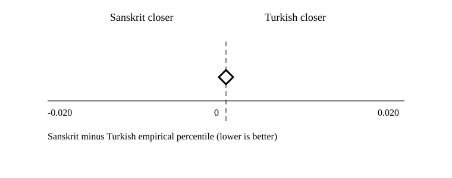
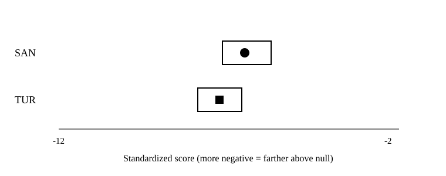
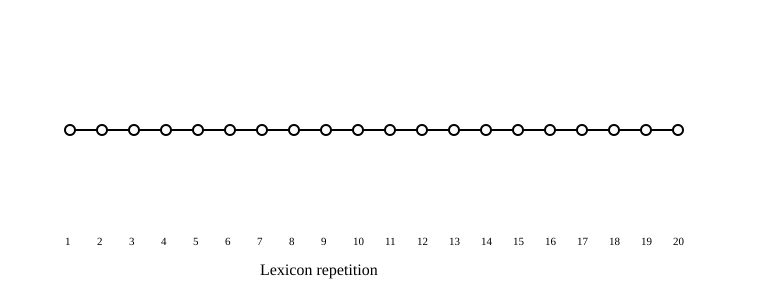

# M4-02 comparative quantitative report

Run ID: `73939edd1372a103413470388d725eef1764e82e09e732a40b9c4d424fa09fb1`. Frozen source bundle: [M4-01 manifest](../../evaluation-run/m4-01/manifest.json).
This report renders committed tidy outputs only. It did not rerun matching or statistics.

## Primary confirmatory result

The preregistered Sanskrit-versus-Turkish comparison did **not** separate the languages. The Sanskrit-minus-Turkish calibrated-percentile effect was **0.000** with a 95% hierarchical-bootstrap interval of **[0.000, 0.000]**, one-sided permutation p = **1.000**, and Holm-adjusted p = **1.000**.

| Analysis | Effect | 95% CI | p | Holm p | Queries | Decision |
| --- | ---: | --- | ---: | ---: | ---: | --- |
| Type-primary | 0.000 | [0.000, 0.000] | 1.000 | 1.000 | 284 | Not met |

Source: [contrasts.csv](tables/contrasts.csv), run `73939edd1372a103413470388d725eef1764e82e09e732a40b9c4d424fa09fb1`, derived from [reports/evaluation-run/m4-01/artifacts/statistics.jsonl.gz](../../evaluation-run/m4-01/artifacts/statistics.jsonl.gz).



The expected direction was negative because lower calibrated percentiles indicate closer matches. The observed effect was zero, its interval did not exclude zero, the corrected p-value exceeded 0.05, every lexicon-subsample median was zero, and holdout replication has not occurred. **The full primary decision rule was not met.** This is a negative confirmatory finding, not evidence that Sanskrit outperformed the unrelated Turkish control.

## Planned sensitivity

| Analysis | Effect | 95% CI | p | Holm p | Status |
| --- | ---: | --- | ---: | ---: | --- |
| Token-frequency weighted | 0.000 | [0.000, 0.000] | 1.000 | 1.000 | estimated |

The planned token-weighted sensitivity agrees with the type-primary result. No mapping variant or post-run sensitivity was introduced.

## Language distributions and winners

| Language | N | Calibrated percentile min / median / max | Standardized score Q1 / median / Q3 | Raw distance median |
| --- | ---: | --- | --- | ---: |
| Sanskrit | 5680 | 1.000 / 1.000 / 1.000 | -7.197 / -6.528 / -5.761 | 4.962 |
| Turkish | 5680 | 0.980 / 1.000 / 1.000 | -7.913 / -7.278 / -6.616 | 4.944 |

At the sample-query level, Sanskrit won 0 of 5680 comparisons, Turkish won 4, and 5676 tied. After collapsing lexicon repetitions by query medians, all 284 query types tied.

Sources: [language-distributions.csv](tables/language-distributions.csv) and [winner-proportions.csv](tables/winner-proportions.csv), run `73939edd1372a103413470388d725eef1764e82e09e732a40b9c4d424fa09fb1`, from [reports/evaluation-run/m4-01/artifacts/calibration.jsonl.gz](../../evaluation-run/m4-01/artifacts/calibration.jsonl.gz).



## Length and section strata

| Dimension | Stratum | Queries | Comparisons | Median effect | Sanskrit wins | Turkish wins | Ties |
| --- | --- | ---: | ---: | ---: | ---: | ---: | ---: |
| length | 01-02 | 19 | 380 | 0.000 | 0 | 4 | 376 |
| length | 03-05 | 158 | 3160 | 0.000 | 0 | 0 | 3160 |
| length | 06-09 | 106 | 2120 | 0.000 | 0 | 0 | 2120 |
| length | 10-20 | 1 | 20 | 0.000 | 0 | 0 | 20 |
| section | f1r | 144 | 2880 | 0.000 | 0 | 4 | 2876 |
| section | f1v | 53 | 1060 | 0.000 | 0 | 0 | 1060 |
| section | f2r | 62 | 1240 | 0.000 | 0 | 0 | 1240 |
| section | f2v | 25 | 500 | 0.000 | 0 | 0 | 500 |

Source: [strata.csv](tables/strata.csv), run `73939edd1372a103413470388d725eef1764e82e09e732a40b9c4d424fa09fb1`, from calibrated tidy rows joined only to frozen query length and locus metadata.

## Lexicon-subsample stability

All 20 preregistered lexicon repetitions had median effect 0.000. The result is stable, but stably null rather than supportive.

Source: [stability.csv](tables/stability.csv), run `73939edd1372a103413470388d725eef1764e82e09e732a40b9c4d424fa09fb1`, from [reports/evaluation-run/m4-01/artifacts/calibration.jsonl.gz](../../evaluation-run/m4-01/artifacts/calibration.jsonl.gz).



## Null calibration

| Language | Cells | Null draws/cell | Observed distance median | Null mean median | Null SD median | Standardized median | Percentile median |
| --- | ---: | ---: | ---: | ---: | ---: | ---: | ---: |
| Sanskrit | 5680 | 100 | 4.962 | 1.997 | 0.455 | -6.528 | 1.000 |
| Turkish | 5680 | 100 | 4.944 | 2.046 | 0.399 | -7.278 | 1.000 |

Observed distances were generally larger than the biphone-pseudoword null, placing almost every cell at the upper empirical-percentile boundary. This ceiling produced the widespread ties; it was not adjusted after inspection.

Source: [null-summary.csv](tables/null-summary.csv), run `73939edd1372a103413470388d725eef1764e82e09e732a40b9c4d424fa09fb1`, from [reports/evaluation-run/m4-01/artifacts/calibration.jsonl.gz](../../evaluation-run/m4-01/artifacts/calibration.jsonl.gz).

## Stage A pronunciation and retrieval quality

| Language | Convention | Evidence basis | Compatible / supported / unique | Bands 03-05 / 06-09 / 10-20 | Pronunciation | Retrieval |
| --- | --- | --- | ---: | --- | --- | --- |
| Sanskrit | sanskrit-slp1-shs | converter-generated; researcher-approved deterministic mapping | 120 / 120 / 120 | 40 / 40 / 40 | passed | passed |
| Turkish | turkish | dictionary-supplied | 10163 / 122 / 122 | 3765 / 5354 / 1044 | passed | passed |

Sanskrit uses the explicitly approved deterministic CDSL SHS/SLP1 converter; this is researcher approval of a pinned mapping, not human pronunciation accuracy. Turkish uses dictionary-supplied readings. Automated reference agreement is not required for either admission route. Both passed every required source-included retrieval cell.

Sources: [quality-summary.csv](tables/quality-summary.csv) and [retrieval.csv](tables/retrieval.csv), run `73939edd1372a103413470388d725eef1764e82e09e732a40b9c4d424fa09fb1`, from [reports/evaluation-readiness/m3-07/admission.json](../../evaluation-readiness/m3-07/admission.json).

## Exclusions and missing comparisons

| Language | Required | Status | Supported units | Reason |
| --- | --- | --- | ---: | --- |
| ara | false | excluded | 0 | insufficient_balanced_units:03-05; insufficient_balanced_units:06-09; insufficient_balanced_units:10-20; insufficient_supported_pronunciation_evidence |
| asm | false | exploratory | 0 | insufficient_balanced_units:03-05; insufficient_balanced_units:06-09; insufficient_balanced_units:10-20; insufficient_supported_pronunciation_evidence |
| ben | false | exploratory | 0 | insufficient_balanced_units:03-05; insufficient_balanced_units:06-09; insufficient_balanced_units:10-20; insufficient_supported_pronunciation_evidence |
| bho | false | excluded | 0 | insufficient_balanced_units:03-05; insufficient_balanced_units:06-09; insufficient_balanced_units:10-20; insufficient_supported_pronunciation_evidence |
| fas | false | exploratory | 0 | insufficient_balanced_units:03-05; insufficient_balanced_units:06-09; insufficient_balanced_units:10-20; insufficient_supported_pronunciation_evidence |
| grc | false | exploratory | 0 | insufficient_balanced_units:03-05; insufficient_balanced_units:06-09; insufficient_balanced_units:10-20; insufficient_supported_pronunciation_evidence |
| guj | false | exploratory | 0 | insufficient_balanced_units:03-05; insufficient_balanced_units:06-09; insufficient_balanced_units:10-20; insufficient_supported_pronunciation_evidence |
| hbo | false | exploratory | 0 | insufficient_balanced_units:03-05; insufficient_balanced_units:06-09; insufficient_balanced_units:10-20; insufficient_supported_pronunciation_evidence |
| hin | false | exploratory | 1 | insufficient_balanced_units:03-05; insufficient_balanced_units:06-09; insufficient_balanced_units:10-20; insufficient_supported_pronunciation_evidence; profile_is_exploratory_only |
| hun | false | exploratory | 0 | insufficient_balanced_units:03-05; insufficient_balanced_units:06-09; insufficient_balanced_units:10-20; insufficient_supported_pronunciation_evidence; profile_is_exploratory_only |
| lat | false | exploratory | 0 | insufficient_balanced_units:03-05; insufficient_balanced_units:06-09; insufficient_balanced_units:10-20; insufficient_supported_pronunciation_evidence |
| mar | false | exploratory | 0 | insufficient_balanced_units:03-05; insufficient_balanced_units:06-09; insufficient_balanced_units:10-20; insufficient_supported_pronunciation_evidence |
| pan | false | exploratory | 0 | insufficient_balanced_units:03-05; insufficient_balanced_units:06-09; insufficient_balanced_units:10-20; insufficient_supported_pronunciation_evidence |
| pus | false | exploratory | 0 | insufficient_balanced_units:03-05; insufficient_balanced_units:06-09; insufficient_balanced_units:10-20; insufficient_supported_pronunciation_evidence |
| rom | false | exploratory | 0 | insufficient_balanced_units:03-05; insufficient_balanced_units:06-09; insufficient_balanced_units:10-20; insufficient_supported_pronunciation_evidence; profile_is_exploratory_only |

Source: [exclusions.csv](tables/exclusions.csv), run `73939edd1372a103413470388d725eef1764e82e09e732a40b9c4d424fa09fb1`.

Only Sanskrit and Turkish were admitted. The three optional exploratory contrasts that require Arabic, Latin/Greek, or Persian were `not_estimable`; they are reported below rather than omitted.

## Exploratory contrasts

| Contrast | Mode | Status | Diagnostic |
| --- | --- | --- | --- |
| arabic-versus-indo-aryan | token-weighted | not_estimable | insufficient_admitted_groups_or_query_pairs |
| arabic-versus-indo-aryan | type-primary | not_estimable | insufficient_admitted_groups_or_query_pairs |
| indo-aryan-versus-latin-greek | token-weighted | not_estimable | insufficient_admitted_groups_or_query_pairs |
| indo-aryan-versus-latin-greek | type-primary | not_estimable | insufficient_admitted_groups_or_query_pairs |
| iranian-bridge-versus-unrelated-controls | token-weighted | not_estimable | insufficient_admitted_groups_or_query_pairs |
| iranian-bridge-versus-unrelated-controls | type-primary | not_estimable | insufficient_admitted_groups_or_query_pairs |

Source: [contrasts.csv](tables/contrasts.csv), run `73939edd1372a103413470388d725eef1764e82e09e732a40b9c4d424fa09fb1`. These contrasts are separate from the primary confirmatory claim and supply no effect estimate.

## Multiplicity, precision, and provenance

- Multiplicity family: four registered contrasts x two analysis modes = eight fixed Holm slots.
- Display precision: effects, intervals, p-values, distances, and proportions are rounded to three decimals; CSV tables retain six decimals.
- Replication unit: query type. Languages are not treated as independent replicates.
- Holdout loci `f3r`, `f3v`, `f4r`, and `f4v` remain unopened.
- Definitions and semantic judgments are absent.
- Figure metadata: [figure-metadata.json](figure-metadata.json), run `73939edd1372a103413470388d725eef1764e82e09e732a40b9c4d424fa09fb1`.

Rebuild from the frozen bundle without rerunning matching or statistics:

```powershell
dotnet run --project Enochian.Benchmark -- report-m4 ..\reports\evaluation-run\m4-01\manifest.json
```
