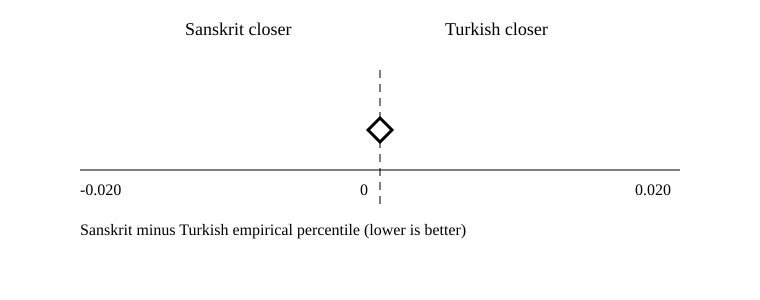
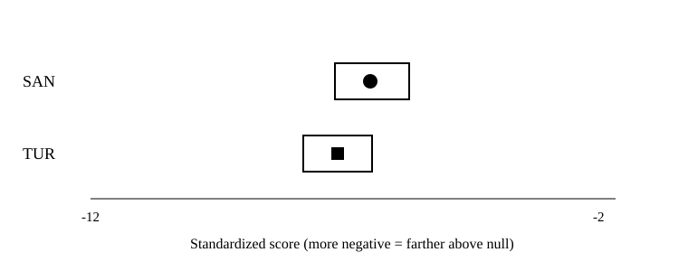
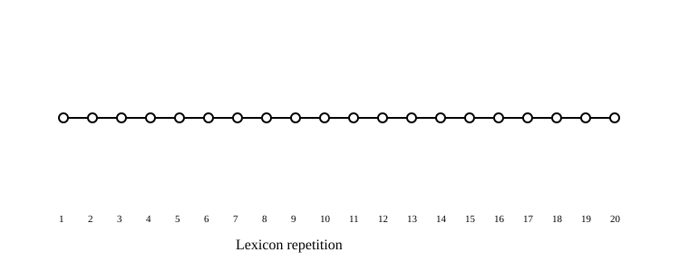

# M4-04 holdout replication and final report

Holdout run ID: `2e43f73d6937971522280b92af80ee1ddf6215df05284b5d0653747abec2cc56`. Frozen source bundle: [M4-04 manifest](../../holdout-run/m4-04/manifest.json).
The preregistered holdout was opened once after the automated leakage audit passed. The unchanged M4-01 runner, mapping, contrast family, seeds, thresholds, and statistics were used.

## Replication decision

| Partition | Effect | 95% CI | Holm p | Partition rule |
| --- | ---: | --- | ---: | --- |
| Evaluation | 0.000 | [0.000, 0.000] | 1.000 | Not met |
| Holdout | 0.000 | [0.000, 0.000] | 1.000 | Not met |

**The frozen replication rule was not met.** Support required a negative effect, an interval excluding zero, Holm-adjusted p <= 0.05, negative effects in every lexicon subsample, and the same result in both partitions. A negative replication is reported without changing the mapping or analysis.

Sources: [holdout contrasts](tables/contrasts.csv), [reports/holdout-run/m4-04/artifacts/statistics.jsonl.gz](../../holdout-run/m4-04/artifacts/statistics.jsonl.gz), and [reports/evaluation-run/m4-01/artifacts/statistics.jsonl.gz](../../evaluation-run/m4-01/artifacts/statistics.jsonl.gz).



## Holdout primary and planned sensitivity

| Analysis | Effect | 95% CI | p | Holm p | Queries | Status |
| --- | ---: | --- | ---: | ---: | ---: | --- |
| Type-primary | 0.000 | [0.000, 0.000] | 1.000 | 1.000 | 227 | estimated |
| Token-frequency weighted | 0.000 | [0.000, 0.000] | 1.000 | 1.000 | 227 | estimated |

## Holdout distributions and winners

| Language | N | Percentile min / median / max | Standardized median | Raw distance median |
| --- | ---: | --- | ---: | ---: |
| Sanskrit | 4540 | 1.000 / 1.000 / 1.000 | -6.679 | 4.956 |
| Turkish | 4540 | 0.980 / 1.000 / 1.000 | -7.301 | 4.906 |

Sanskrit won 0 of 4540 sample-query comparisons; Turkish won 2; 4538 tied. After collapsing repetitions, 227 of 227 query types tied.



## Holdout length and locus strata

| Dimension | Stratum | Queries | Comparisons | Median effect | Sanskrit wins | Turkish wins | Ties |
| --- | --- | ---: | ---: | ---: | ---: | ---: | ---: |
| length | 01-02 | 9 | 180 | 0.000 | 0 | 2 | 178 |
| length | 03-05 | 112 | 2240 | 0.000 | 0 | 0 | 2240 |
| length | 06-09 | 106 | 2120 | 0.000 | 0 | 0 | 2120 |
| section | f3r | 79 | 1580 | 0.000 | 0 | 0 | 1580 |
| section | f3v | 63 | 1260 | 0.000 | 0 | 0 | 1260 |
| section | f4r | 35 | 700 | 0.000 | 0 | 0 | 700 |
| section | f4v | 50 | 1000 | 0.000 | 0 | 2 | 998 |

## Stability and null calibration

0 of 20 frozen repetitions had an effect in the expected negative direction.



| Language | Cells | Null draws/cell | Observed median | Null mean median | Percentile median |
| --- | ---: | ---: | ---: | ---: | ---: |
| Sanskrit | 4540 | 100 | 4.956 | 1.995 | 1.000 |
| Turkish | 4540 | 100 | 4.906 | 2.051 | 1.000 |

## Stage A quality and exclusions

| Language | Compatible / supported / unique | Pronunciation | Retrieval |
| --- | ---: | --- | --- |
| Sanskrit | 120 / 120 / 120 | passed | passed |
| Turkish | 10163 / 122 / 122 | passed | passed |

15 profiles remained excluded; the holdout did not change admission.

## Final research bundle

| Component | Frozen artifact |
| --- | --- |
| Protocol and decision rule | [protocol-v2](../../../experiments/protocol-v2.md) |
| Holdout protocol | [confirmatory.holdout.m4-04.json](../../../experiments/confirmatory.holdout.m4-04.json) |
| Mapping approval | [decision package](../../mapping-preregistration/v1/decision-package.json) |
| Pre-open leakage audit | [leakage audit](../../holdout-materialization/m4-04/leakage-audit.json) |
| Holdout query provenance | [materialization](../../holdout-materialization/m4-04/materialization.md) |
| Evaluation run and report | [M4-01](../../evaluation-run/m4-01/README.md); [M4-02](../../evaluation-report/m4-02/report.md) |
| Holdout run | [M4-04 bundle](../../holdout-run/m4-04/README.md) |
| Optional context | [M4-03](../../contextual-appendix/m4-03/report.md) |
| Licenses and acquisition | [lexicons](../../../resources/lexicons/README.md); [Voynich transcription](../../../resources/voynich/links.md) |

Every displayed holdout number is present in the CSV tables and traces to the holdout run ID. Definitions and glosses were absent from both primary partitions. The optional contextual appendix was never consumed by this analysis.

## Reproduction

From `source/` with the pinned SDK and retained licensed snapshots:

```powershell
dotnet run --project Enochian.Provenance -- voynich-holdout ..\experiments\holdout-materialization.m4-04.json
dotnet run --project Enochian.Benchmark -- preflight ..\experiments\confirmatory.holdout.m4-04.json
dotnet run --project Enochian.Benchmark -- experiment ..\experiments\confirmatory.holdout.m4-04.json
dotnet run --project Enochian.Benchmark -- publish-holdout-m4 ..\experiments\confirmatory.holdout.m4-04.json c8b258128eb161ff5ef0d82551bc15460f69af65
dotnet run --project Enochian.Benchmark -- report-m4 ..\reports\holdout-run\m4-04\manifest.json reports/final-report/m4-04
```

The materializer refuses a second write after publication; reproduce in a fresh checkout/output path. The unrestricted experiment does not require BHSA. BHSA is optional only for rebuilding the separate Tiberian Hebrew source; the lexicon guide documents its authorized acquisition.

## Limitations

- The fixed Vogt-derived mapping remains speculative.
- Calibrated-percentile ceiling effects can create extensive ties.
- The holdout has no scorable 10-20-symbol query type; no long-band result was imputed.
- Language profiles differ in source coverage; languages are not independent replicates.
- The holdout result is final under this preregistration; no mapping or threshold was refit.
- Semantic context and astronomy remain secondary and cannot rescue failed phonological replication.

## Artifact inventory

- [contrasts.csv](tables/contrasts.csv)
- [language-distributions.csv](tables/language-distributions.csv)
- [winner-proportions.csv](tables/winner-proportions.csv)
- [strata.csv](tables/strata.csv)
- [stability.csv](tables/stability.csv)
- [null-summary.csv](tables/null-summary.csv)
- [quality-summary.csv](tables/quality-summary.csv)
- [retrieval.csv](tables/retrieval.csv)
- [exclusions.csv](tables/exclusions.csv)
- [figure-metadata.json](figure-metadata.json)
